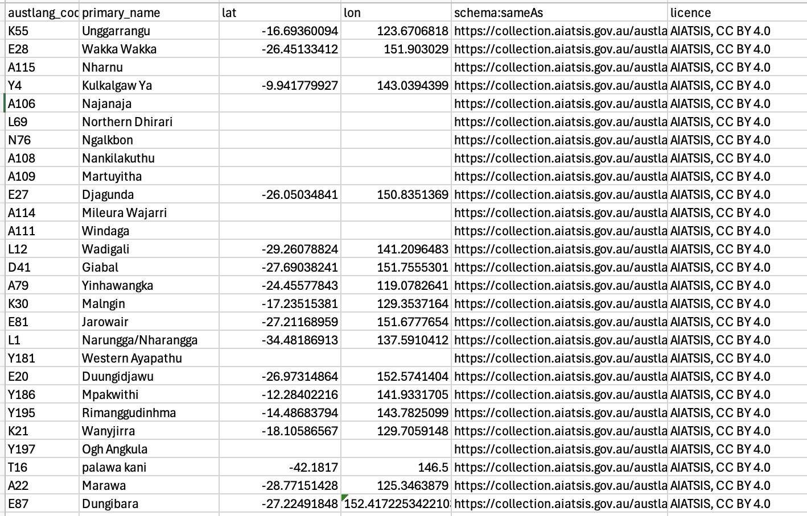
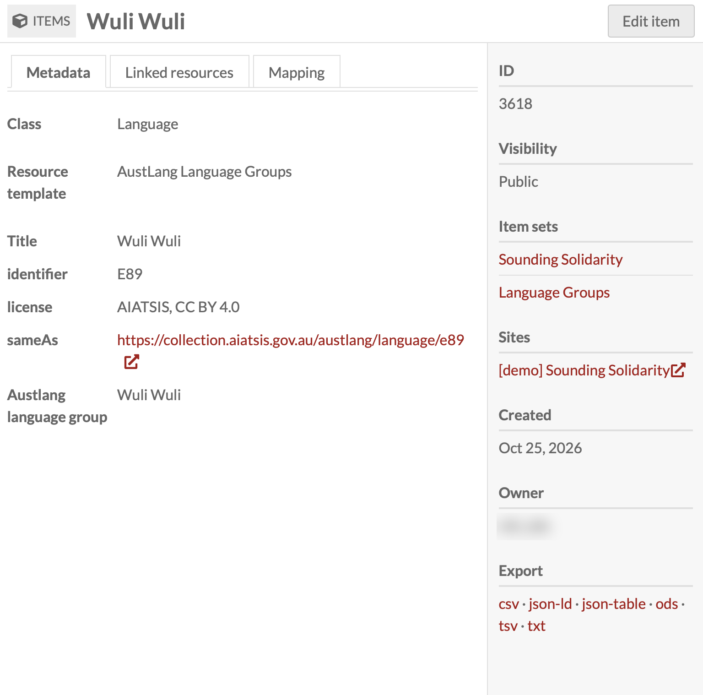
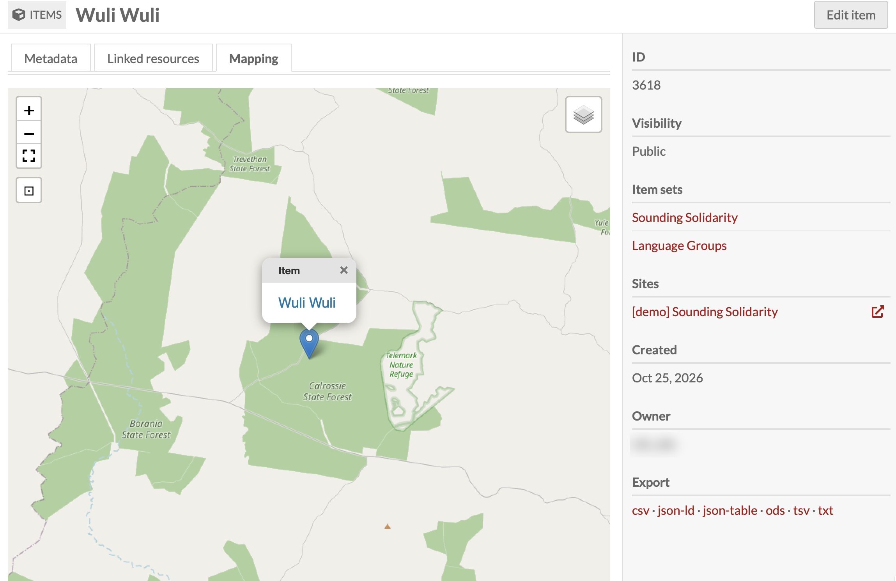

# Using AustLang language codes

*Connect your collection to Aboriginal and Torres Strait Islander languages, peoples and places.*

> ⚠️ **Cultural warning:** Aboriginal and Torres Strait Islander readers are advised that this page contains names of people who have died. Photographs of people in the screenshots have been blurred.

If your collection includes people, artworks, recordings, events or places connected to Aboriginal and Torres Strait Islander communities, you can describe those connections using **AustLang**, the national reference of Australian Indigenous languages. Using AustLang codes means everyone in your collection refers to a language group in the same way, and links your records to a trusted external source.

## What is AustLang?

[AustLang](https://collection.aiatsis.gov.au/austlang/about) is maintained by the [Australian Institute of Aboriginal and Torres Strait Islander Studies (AIATSIS)](https://aiatsis.gov.au/). It brings together information about Indigenous Australian languages from referenced sources.

Each language in AustLang has:

- A **unique code** (for example `E89` for Wuli Wuli) that works as a stable identifier
- A **primary name**, plus alternative names and spellings
- An **approximate location** (latitude and longitude) for the language variety
- A **URI** (web address) for the language's AustLang page, such as `https://collection.aiatsis.gov.au/austlang/language/e89`

AustLang is a live dataset that AIATSIS updates regularly, so check back for changes before major updates to your collection.

## Licence and use of AustLang data

> 📄 **The AustLang data in this guide comes from AIATSIS.**

AIATSIS publishes the AustLang dataset under a [Creative Commons Attribution 4.0 International (CC BY 4.0)](https://creativecommons.org/licenses/by/4.0/) licence. This means you can copy, share, adapt and reuse the data, including in your Omeka-S collection, **as long as you credit AIATSIS as the source**.

When you use AustLang data:

- **Attribute AIATSIS.** Include a licence statement on each language record (for example `AIATSIS, CC BY 4.0`) and an acknowledgement on your site. A suggested acknowledgement is below.
- **Link back to the source.** Use the AustLang URI for each language in a `schema:sameAs` (or similar) field.
- **Do not change the meaning of the data.** You can choose which fields to import, but don't present edited codes or names as if they were AIATSIS data.
- **Remember the locations are approximate.** AustLang coordinates mark an approximate point for a language variety. They are **not** boundaries of Country, land claims or native title areas, and should not be presented as such.

**Suggested acknowledgement:**

> Language information in this collection is sourced from AustLang, Australian Institute of Aboriginal and Torres Strait Islander Studies (AIATSIS), licensed under CC BY 4.0. [https://collection.aiatsis.gov.au/austlang/about](https://collection.aiatsis.gov.au/austlang/about)

You can download the full dataset as a CSV from the [AustLang dataset page](https://collection.aiatsis.gov.au/datasets/austlang/001). It is also listed on [data.gov.au](https://data.gov.au/data/dataset/austlang-dataset-001).

## Ethics and cultural considerations

AustLang is a reference tool, not the final word on how a community names or identifies itself. Before linking people, objects or stories to a language group:

- **Work with communities.** The language group a person or family identifies with, and the spelling they prefer, should come from them, not just from a reference list.
- **Apply the CARE principles.** See [CARE principles](10-care-principles.md) for guidance on collective benefit, authority to control, responsibility and ethics.
- **Follow the AIATSIS Code of Ethics.** The [AIATSIS Code of Ethics for Aboriginal and Torres Strait Islander Research](https://aiatsis.gov.au/research/ethical-research/code-ethics) sets out expectations for research involving Indigenous peoples.
- **Think about what is public.** Linking a person to a language group is a statement about their identity. Check it is accurate and that you have permission before publishing.
- **Add cultural warnings** where your collection includes images, voices or names of people who have died.

## Preparing the AustLang data

The image below shows a spreadsheet prepared from the AustLang dataset, ready for import into Omeka-S.

*AustLang data © AIATSIS, CC BY 4.0.*

Each column maps to a property in Omeka-S:

| Column | What it contains | Suggested Omeka-S property |
|--------|------------------|----------------------------|
| `austlang_code` | The AustLang code, e.g. `E89` | `dcterms:identifier` |
| `primary_name` | The language name, e.g. `Wuli Wuli` | `dcterms:title` |
| `lat` / `lon` | Approximate latitude and longitude | Mapping module (latitude / longitude) |
| `schema:sameAs` | The AustLang URI | `schema:sameAs` (as a URI) |
| `licence` | `AIATSIS, CC BY 4.0` | `dcterms:license` |

A few things to check before importing (see [Data cleaning](06-data-cleaning.md)):

- **Some languages have no coordinates.** Rows with empty `lat` and `lon` columns will import as items but won't appear on a map.
- **Check number formats.** Spreadsheet software can store some coordinates as text (look for a small green triangle in the cell corner). Make sure all coordinates are plain numbers.
- **Only import what you need.** You can import the full list, or only the language groups relevant to your collection.

## Two ways to add language groups

There are two ways to bring AustLang into your collection. Choose the one that suits your project.

| | Option 1: Language groups as items | Option 2: Custom Vocab dropdown |
|---|---|---|
| How it works | Each language group is its own item | Language names are a fixed list in a dropdown |
| Mapping | ✅ Yes, each language can show on a map | ❌ No mapping |
| Extra details (code, URI, licence) | ✅ Stored on the language item | Limited to the term itself |
| Linking other records | ✅ People, artworks, events and places link to the language item, and you can see everything connected to it | Records share the same label, but there's no language page to browse |
| Best for | Collections where language and place are central | Simple, consistent tagging |

### Option 1: Add language groups as items (with mapping)

With this option, each language group becomes an item in Omeka-S with its own metadata and map location.

1. **Create a resource template** for language groups (for example *AustLang Language Groups*) with the properties listed above.
2. **Create an item set** (for example *Language Groups*) to hold the language items.
3. **Import the spreadsheet** using [CSV Import](02-csv-import.md). Map the `lat` and `lon` columns to the Mapping module's latitude and longitude fields, and import `schema:sameAs` as a URI.
4. **Check a few records** after import.

The **Metadata** tab shows the language group's details, including its AustLang code, licence and a `sameAs` link back to the AustLang page.

*Language data © AIATSIS, CC BY 4.0. Owner details blurred.*

The **Mapping** tab shows the approximate location of the language variety, using the coordinates from AustLang.

*Location is approximate and does not represent the boundaries of Country. Owner details blurred.*

#### Linking records back to a language group

Once language groups are items, **other items can link to them**. For example, a person, artwork, recording, event or place can link to the language group it belongs to.

In the example below, the person links to the **Wuli Wuli** language item in the *Austlang language group* field. Selecting the link opens the language group record with all its details. The same language item also appears under `isPartOf'.

*Photographs and owner details blurred.*

To link an item to a language group:

1. Add a property such as *Austlang language group* to your resource template (for example *Person*), with the data type set to **Omeka resource → Items**.
2. When editing an item, select the language group item from the list.

Because the link works in both directions, the language group's **Linked resources** tab lists every person, artwork, event or place connected to it. This lets visitors browse everything in your collection associated with a language group.

### Option 2: Add language groups as a Custom Vocab (dropdown, no mapping)

If you only need a consistent list of language names, you can use the [Custom Vocab](08-controlled-vocabularies.md) module instead.

1. In the admin menu, go to **Custom Vocab** and create a new vocabulary (for example *AustLang languages*).
2. Paste in the language names you need, one per line. You can include the code with the name (for example `Wuli Wuli (E89)`) to keep the AustLang identifier visible.
3. Add a property to your resource template and set its data type to your new Custom Vocab.
4. When editing an item, choose the language group from the dropdown.

This option is quicker to set up, but language groups won't have their own pages, map locations or `sameAs` links. Remember to include the AIATSIS acknowledgement on your site.

## References

This module has been developed using the following resources:

Australian Institute of Aboriginal and Torres Strait Islander Studies. (n.d.). AustLang. [https://collection.aiatsis.gov.au/austlang/about](https://collection.aiatsis.gov.au/austlang/about)

Australian Institute of Aboriginal and Torres Strait Islander Studies. (n.d.). Austlang dataset [Data set]. CC BY 4.0. [https://collection.aiatsis.gov.au/datasets/austlang/001](https://collection.aiatsis.gov.au/datasets/austlang/001)

Australian Institute of Aboriginal and Torres Strait Islander Studies. (2020). AIATSIS Code of Ethics for Aboriginal and Torres Strait Islander Research. [https://aiatsis.gov.au/research/ethical-research/code-ethics](https://aiatsis.gov.au/research/ethical-research/code-ethics)

Australian Research Data Commons. (2025). CARE Principles for Indigenous Data Governance. [https://ardc.edu.au/resource/the-care-principles/](https://ardc.edu.au/resource/the-care-principles/)

Creative Commons. (n.d.). Attribution 4.0 International (CC BY 4.0). [https://creativecommons.org/licenses/by/4.0/](https://creativecommons.org/licenses/by/4.0/)
