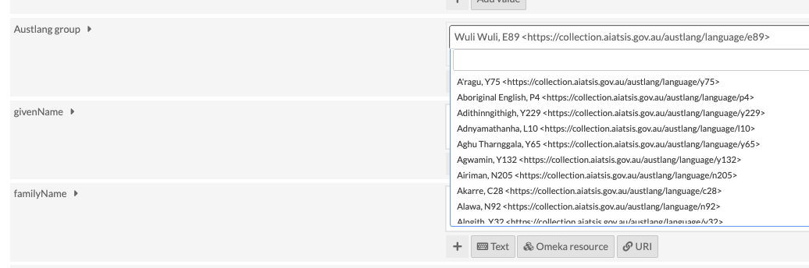
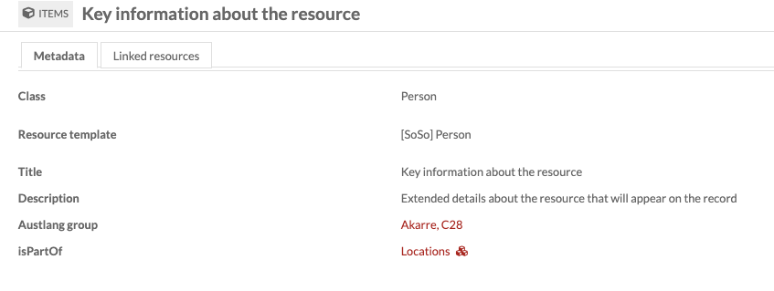
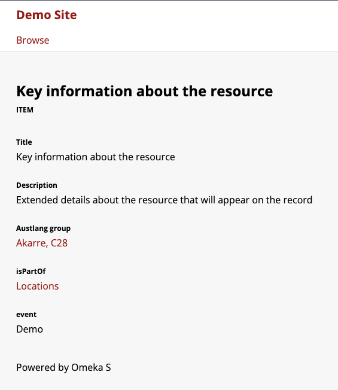

# Using AustLang language groups

*Connect your collection to Aboriginal and Torres Strait Islander languages.*

If your collection includes records connected to Aboriginal and Torres Strait Islander communities, you can describe those connections using **AustLang**, the national reference of Australian Indigenous languages. Using AustLang means every record in your collection refers to a language group in the same way, and links your records to a trusted external source.

In Curated Collections, AustLang is **already installed** as a Custom Vocab. You don't need to download or import anything: you just choose a language group from a dropdown list.

## What is AustLang?

[AustLang](https://collection.aiatsis.gov.au/austlang/about) is maintained by the [Australian Institute of Aboriginal and Torres Strait Islander Studies (AIATSIS)](https://aiatsis.gov.au/). It brings together information about Indigenous Australian languages from referenced sources.

Each language in AustLang has:

- A **unique code** (for example `E89` for Wuli Wuli) that works as a stable identifier
- A **primary name**, plus alternative names and spellings
- An **approximate location** (latitude and longitude) for the language variety
- A **URI** (web address) for the language's AustLang page, such as `https://collection.aiatsis.gov.au/austlang/language/e89`

The AustLang vocabulary in Curated Collections uses the code, primary name and URI for each language.

## Licence and use of AustLang data

> 📄 **The AustLang data in this guide comes from AIATSIS.**

AIATSIS publishes the AustLang dataset under a [Creative Commons Attribution 4.0 International (CC BY 4.0)](https://creativecommons.org/licenses/by/4.0/) licence. This means you can copy, share, adapt and reuse the data, including in your Omeka-S collection, **as long as you credit AIATSIS as the source**.

When you use AustLang data:

- **Attribute AIATSIS.** Include an acknowledgement on your site. A suggested acknowledgement is below.
- **Do not change the meaning of the data.** Don't present edited codes or names as if they were AIATSIS data.
- **Remember the locations are approximate.** AustLang coordinates mark an approximate point for a language variety. They are **not** boundaries of Country, land claims or native title areas, and should not be presented as such.

The vocabulary links every language group back to its AustLang page, so the link to the source is built in.

**Suggested acknowledgement:**

> Language information in this collection is sourced from AustLang, Australian Institute of Aboriginal and Torres Strait Islander Studies (AIATSIS), licensed under CC BY 4.0. [https://collection.aiatsis.gov.au/austlang/about](https://collection.aiatsis.gov.au/austlang/about)

For more about licences and acknowledging sources, see [Copyright and licensing](13-copyright-and-licensing.md).

## Ethics and cultural considerations

AustLang is a reference tool, not the final word on how a community names or identifies itself. Before linking records to a language group:

- **Work with communities.** The language group a person, family or community identifies with, and the spelling they prefer, should come from them, not just from a reference list.
- **Apply the CARE principles.** See [CARE principles](14a-care-principles.md) for guidance on collective benefit, authority to control, responsibility and ethics.
- **Follow the AIATSIS Code of Ethics.** The [AIATSIS Code of Ethics for Aboriginal and Torres Strait Islander Research](https://aiatsis.gov.au/research/ethical-research/code-ethics) sets out expectations for research involving Indigenous peoples.
- **Think about what is public.** Linking a record to a language group is a statement about identity and connection to Country. Check it is accurate and that you have permission before publishing.
- **Record cultural rights.** Records connected to a language group often contain Indigenous Cultural and Intellectual Property. Add a cultural rights statement and any access conditions. See [Cultural rights: ICIP and ICMR](14c-cultural-rights.md).
- **Add cultural warnings** where your collection includes images, voices or names of people who have died.

## Adding a language group to an item

The AustLang vocabulary works like any other Custom Vocab (see [Controlled vocabularies and Value Suggest](11-controlled-vocabularies.md)). If your resource template includes a language group field set to the AustLang vocabulary, the dropdown appears automatically when you edit an item.

1. **Open the item** and click **Edit**.
2. **Find the language group field.** In the example below, the field has the label *Austlang group*.
3. **Click the dropdown** to open the list of language groups. Each entry shows the language name, its AustLang code and its AustLang URI.
4. **Type in the search box** to filter the list. You can search by language name (for example `Wuli`) or by code (for example `E89`).
5. **Select the language group.**
6. **Click Save.**

*Language data © AIATSIS, CC BY 4.0.*

A few tips:

- **More than one language group?** Click **Add value** below the field to add another.
- **Field not in your template?** Add a property to your resource template (for example, an *Austlang group* label on a suitable property) and set its data type to the AustLang Custom Vocab. See [Adding items](03-adding-items.md) for working with resource templates.
- **Can't find a language group?** Try searching by an alternative spelling or by code. AustLang lists one primary name for each language, which may differ from the spelling a community uses.
- **Community uses a different name or spelling?** Keep the AustLang value so the record stays linked, and record the community's preferred name in another field, such as a description or alternative name.
- **Vocabulary out of date?** AustLang is a live dataset that AIATSIS updates regularly, while the vocabulary is a copy taken at a point in time. If a language is missing or its details have changed on the AustLang site, contact your platform administrator.

## How language groups display

Each language group is saved with **two parts**: a label (for example *Wuli Wuli, E89*) and the AustLang URI. Omeka-S shows the label, and turns it into a link to the language's AustLang page on the AIATSIS website.

### In the admin view

On the item's page in the admin dashboard, the language group appears in the **Metadata** tab as a red link.

*Names and images have been blurred. Language data © AIATSIS, CC BY 4.0.*

### On your public site

On your public site, visitors see the same label as a link. Clicking it opens the language's page in AustLang, where they can find more about the language from AIATSIS, the trusted source.

*Names and images have been blurred. Language data © AIATSIS, CC BY 4.0.*

### Why the link matters

- **Visitors can find out more.** Every language group links to AIATSIS's information about that language.
- **It credits the source.** The link back to AustLang supports the attribution AIATSIS asks for.
- **It makes your data linked open data.** Because each value is stored with its URI, other systems can recognise that records in your collection and in other collections refer to the same language. See [Linked open data](12-linked-open-data.md).
- **Records stay consistent.** Everyone chooses from the same list, so there are no spelling variations within your collection, and you can find all records linked to a language group with a search.

## Related pages

- [Controlled vocabularies and Value Suggest](11-controlled-vocabularies.md)
- [Linked open data](12-linked-open-data.md)
- [Copyright and licensing](13-copyright-and-licensing.md)
- [CARE principles](14a-care-principles.md)
- [Cultural rights: ICIP and ICMR](14c-cultural-rights.md)

## References

This module has been developed using the following resources:

Australian Institute of Aboriginal and Torres Strait Islander Studies. (n.d.). AustLang. [https://collection.aiatsis.gov.au/austlang/about](https://collection.aiatsis.gov.au/austlang/about)

Australian Institute of Aboriginal and Torres Strait Islander Studies. (n.d.). Austlang dataset [Data set]. CC BY 4.0. [https://collection.aiatsis.gov.au/datasets/austlang/001](https://collection.aiatsis.gov.au/datasets/austlang/001)

Australian Institute of Aboriginal and Torres Strait Islander Studies. (2026). Austlang dataset [Data set]. data.gov.au. CC BY 4.0. [https://data.gov.au/data/dataset/austlang-dataset-001](https://data.gov.au/data/dataset/austlang-dataset-001)

Australian Institute of Aboriginal and Torres Strait Islander Studies. (2026). Austlang dataset [Data set record]. Research Data Australia, Australian Research Data Commons. [https://researchdata.edu.au/austlang-dataset/3801079](https://researchdata.edu.au/austlang-dataset/3801079)

Australian Institute of Aboriginal and Torres Strait Islander Studies. (2020). AIATSIS Code of Ethics for Aboriginal and Torres Strait Islander Research. [https://aiatsis.gov.au/research/ethical-research/code-ethics](https://aiatsis.gov.au/research/ethical-research/code-ethics)

Australian Research Data Commons. (2025). CARE Principles for Indigenous Data Governance. [https://ardc.edu.au/resource/the-care-principles/](https://ardc.edu.au/resource/the-care-principles/)

Creative Commons. (n.d.). Attribution 4.0 International (CC BY 4.0). [https://creativecommons.org/licenses/by/4.0/](https://creativecommons.org/licenses/by/4.0/)

Omeka. (n.d.). Custom Vocab. Omeka S user manual. [https://omeka.org/s/docs/user-manual/modules/customvocab/](https://omeka.org/s/docs/user-manual/modules/customvocab/)
