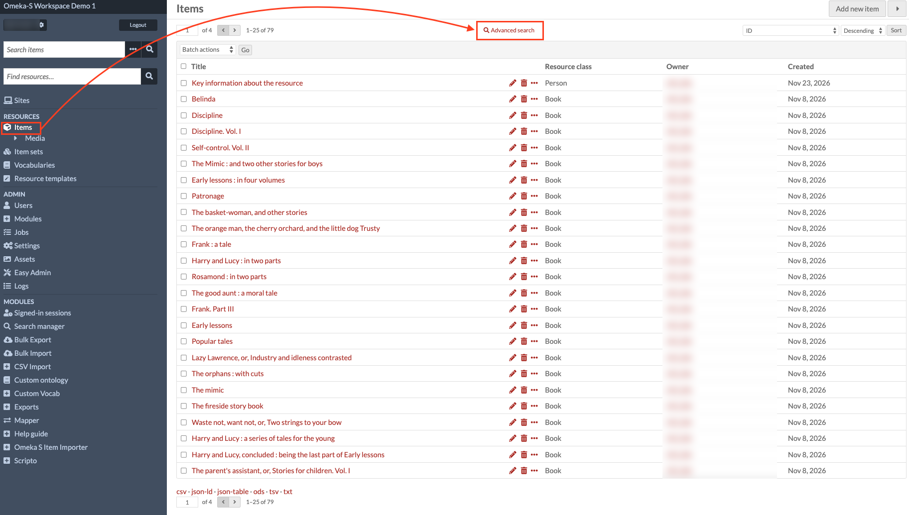

# Search and query

*Find exactly the records you need, check your data and work with the results.*

Omeka-S has several ways to search. A **quick search** finds records by keyword. **Advanced search** lets you build a query from several conditions, such as every Person item in a particular item set that has no date of birth. You can then sort, export or batch edit the results.

Searching isn't only for finding things. It is one of the best tools for checking the quality of your collection before you publish, for example by finding items with a missing field or without a rights statement.

## Ways to search

| Search | Where to find it | Use it to... |
| --- | --- | --- |
| **Quick search** | The *Search items* box at the top of the left-hand menu in the admin dashboard | Find records by keyword |
| **Advanced search** | The **Advanced search** link on the Items, Item sets or Media pages | Combine conditions to find a precise set of records |
| **Public site search** | The search bar and **Advanced search** link on your public site | See what visitors can find |

## Quick search

The search box near the top of the left-hand menu runs a keyword search across all the properties of your resources. Type a word or phrase and press **Enter**, or click the magnifying glass.

By default it searches **items**. To search **item sets** or **media** instead, click the **•••** button beside the box and choose the resource type.

## Advanced search

### Where to find it

From the main **Items** screen, click **Advanced search**, next to the page count near the top.

*Owner names have been blurred.*

The Item sets and Media pages have their own **Advanced search** link in the same place. Each searches only that type of resource.

### The advanced search form

The form opens on a new page. You can fill in as many or as few fields as you need. Every field you fill in **narrows** the results, so a search with many conditions returns fewer records.

*This example fills in every field to show what's available. In practice, you would only use the few fields you need: a search this specific is likely to return no results.*

When you're ready, click **Search** at the top right. Click **Reset** to clear the form and start again.

### What each field does

| Field | What it does | Example |
| --- | --- | --- |
| **Sort** | Sets the order of the results, ascending or descending | Sort by *Created*, oldest first |
| **Search full-text** | Searches all the text in every item | `Operetta` finds any item that mentions it anywhere |
| **Search by value** | Searches one property for a value, using an operator (see below) | *Title* **contains** `Operetta` |
| **Filters** | Adds more property conditions, joined with **and** or **or**. This row is added by a search module in Curated Collections | *associatedMedia* **contains** `Performance` |
| **Search by class** | Finds items with a particular class, whichever template created them | All *Event* items |
| **Search by template** | Finds items created with a particular resource template | All items made with the *Person* template |
| **Search by item set** | Finds items **in** or **not in** an item set | Items in *Authors* |
| **Search by site** | Finds items assigned to a site (one site at a time) | Items on *Demo Site* |
| **Search by media presence** | Finds items that have, or don't have, media | Items with no media attached |
| **Search by owner** | Finds items created by a particular user | Items you created |
| **Search by visibility** | Finds public items, private items, or both | Private items only |
| **Search by ID** | Finds items by their Omeka ID; separate several IDs with commas | `12, 45, 46` |
| **Date comes on or after / before** | Finds items with a date in a range (see [Searching by date](#searching-by-date)) | Born on or after 1900 |

Fields with a red **+** (value, filters, class, template and item set) let you add more than one condition. Click the **+** to add a row, and the trash icon to remove one.

### Search by value operators

**Search by value** has three parts: the **property** to search, an **operator** that sets how to match, and the **value** to look for. The operators are:

| Operator | Finds items where the property... | Example |
| --- | --- | --- |
| **is exactly** | Matches the value exactly | *Title* is exactly `Belinda` |
| **is not exactly** | Doesn't exactly match the value | *Title* is not exactly `Belinda` |
| **contains** | Includes the value anywhere | *Title* contains `Harry` |
| **does not contain** | Doesn't include the value | *Description* does not contain `draft` |
| **is resource with ID** | Links to the item with this ID | *Creator* is resource with ID `125` |
| **is not resource with ID** | Doesn't link to the item with this ID | *Creator* is not resource with ID `125` |
| **has any value** | Has something in it | *Date of birth* has any value |
| **has no values** | Is empty | *Rights* has no values |
| **has data type** | Has a value of a particular data type, such as URI or a Custom Vocab | *Austlang group* has data type *AustLang* |
| **does not have data type** | Has no value of that data type | *Subject* does not have data type *URI* |

Your installation may show a few more operators, such as **starts with** and **ends with**, depending on its version and modules.

> 💡 **Finding an ID:** Open the item and look at the address bar in your browser. The number at the end of the address is the item's ID.

### Combining conditions

When you add more than one row to **Search by value** or **Filters**, choose how each new row joins the ones before it:

- **and** returns items that match **all** the conditions. *Class* is Person **and** *Date of death* has no values finds people with no recorded date of death.
- **or** returns items that match **any** of the conditions. *Title* contains `Harry` **or** *Title* contains `Lucy` finds items with either word in the title.

Different fields always combine with **and**. For example, filling in **Search by class** and **Search by item set** finds items that match both.

### Searching by date

The **Date comes on or after** and **Date comes on or before** fields search dates as real dates, rather than as text. Choose the property, then enter a year, and optionally a month and day. Use both fields together to search a range, such as between 1900 and 1950.

These fields only find dates entered with the **Timestamp** data type. Dates typed in as plain text, such as `c. 1920` or `March 1920`, won't be found this way. Use **Search by value** with **contains** for those instead. If you want dates to be searchable as ranges, enter them with the Timestamp data type when you add or import your records.

## Working with your results

### Sorting

Use the two dropdowns and the **Sort** button at the top right of the results to change the order, for example by *Title* ascending (A–Z) or *Created* descending (newest first). Results from a full-text search are sorted by relevance, with the closest matches first.

Dates typed as text sort alphabetically rather than in date order, so `c. 1920` won't sort where you might expect.

### Exporting results

Below the results table are links to download the results in other formats: **csv**, **json-ld**, **json-table**, **ods**, **tsv** and **txt**. The download covers the results of your whole search, not just the page you can see, so it's worth checking the number of rows matches the result count.

CSV and ODS open in spreadsheet programs such as Excel. They're useful for checking or cleaning data (see [Data cleaning](09-data-cleaning.md)).

### Batch editing results

To change many records at once, tick the items you want, or tick the box in the table header to select the page. Then choose an option from the **Batch actions** menu and click **Go**. Batch editing changes records permanently, so check your search results carefully first.

### Saving and sharing a search

Your search is saved in the web address of the results page. To run it again later, bookmark the page or copy the address. Anyone with access to the dashboard can open the same address to see the same search.

## Searching media and item sets

**Media** and **item sets** have their own advanced search, from the **Advanced search** link on their pages. The forms are similar to the item search, with a few differences:

- **Media** search adds **Search by MIME type**, which finds files of a particular format. For example, enter `image/tiff` for TIFF images or `application/pdf` for PDFs.
- **Item set** search has fewer fields, as item sets don't belong to other item sets or have media.

## Searching your public site

Visitors to your public site can search too:

- **Basic search:** the search bar on your site searches items, item sets, media and site pages together, and groups the results by type.
- **Advanced search:** if your site has a Browse Items page, visitors see an **Advanced search** link above the results with a simpler version of the form.

Public search only finds **public** records assigned to that site. Try searching your site as a visitor would before you publish, to check that people can find what they need and that private material doesn't appear. Site administrators can change which search fields are shown from the site's **Settings**.

## Useful queries

Searching is a quick way to check your collection. These queries help you find gaps and problems before you publish:

| To find... | Set up the search |
| --- | --- |
| Items with no title | *Title* **has no values** |
| Items missing a licence or rights statement | *License* (`schema:license`) **has no values** |
| Items still marked "Copyright Not Evaluated" | *License* **contains** `CNE` |
| Items linked to a language group but with no ICIP statement | *Austlang group* **has any value**, **and** *Usage info* (`schema:usageInfo`) **has no values** |
| Items linked to a particular language group | *Austlang group* **contains** `Wuli Wuli` (or the code, `E89`) |
| Items linked to a particular person | The linking property, such as *Creator*, **is resource with ID** and the person's item ID |
| Items without a URI identifier | *sameAs* **does not have data type** *URI* |
| Private items | **Search by visibility**: *Not public* |
| Items with no media | **Search by media presence**: *Has no media* |
| Items not yet in any item set | **Search by item set**: *Not in* each of your item sets, one row per set |

The property labels you see depend on your resource templates, so a field may appear under a different name in your collection.

> 💡 **Tip:** Save the addresses of searches you run often, such as "items missing a rights statement", and run them again before each round of publishing. The [Pre-publication checklist](08-pre-publication-checklist.md) lists other checks to make.

## Related pages

- [Getting started](02-getting-started.md)
- [Adding items](03-adding-items.md)
- [CSV Import](05-csv-import.md)
- [Pre-publication checklist](08-pre-publication-checklist.md)
- [Data cleaning](09-data-cleaning.md)
- [Copyright and licensing](13-copyright-and-licensing.md)
- [AustLang language groups](14b-austlang-language-groups.md)

## References

This module has been developed using the following resources:

Omeka. (n.d.). Searching. Omeka S user manual. [https://omeka.org/s/docs/user-manual/search/](https://omeka.org/s/docs/user-manual/search/)

Omeka. (n.d.). Numeric Data Types. Omeka S user manual. [https://omeka.org/s/docs/user-manual/modules/numericdatatypes/](https://omeka.org/s/docs/user-manual/modules/numericdatatypes/)
